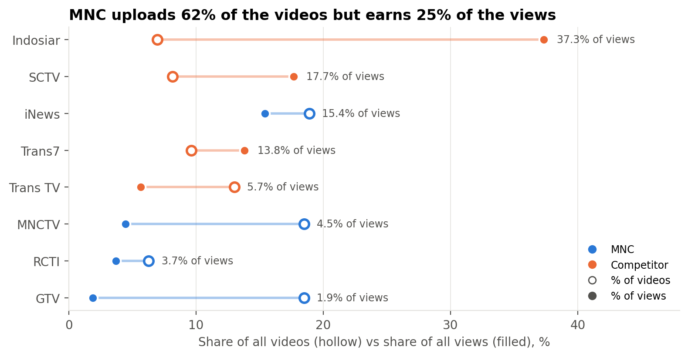
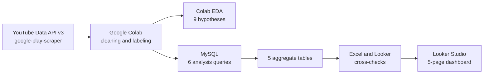
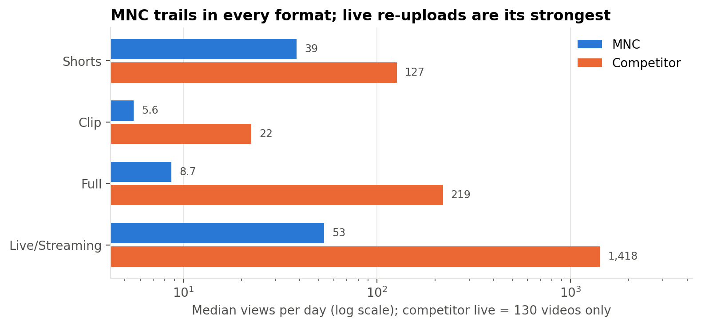
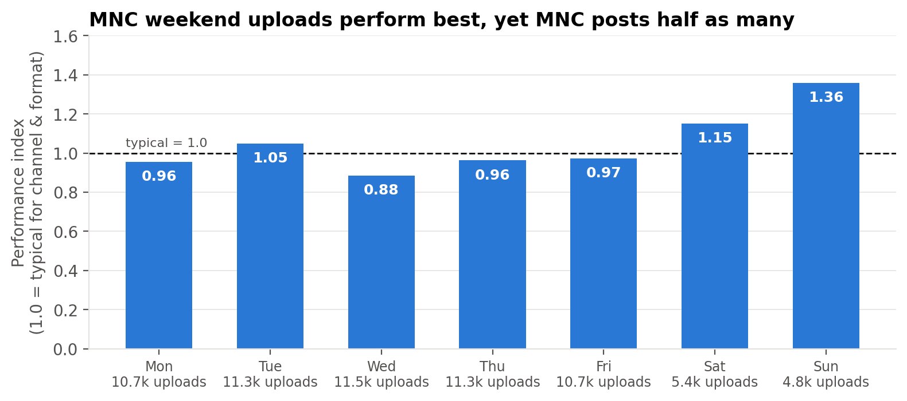
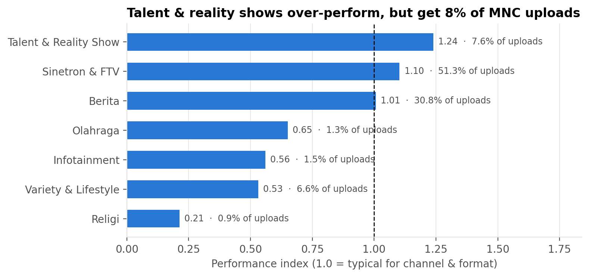
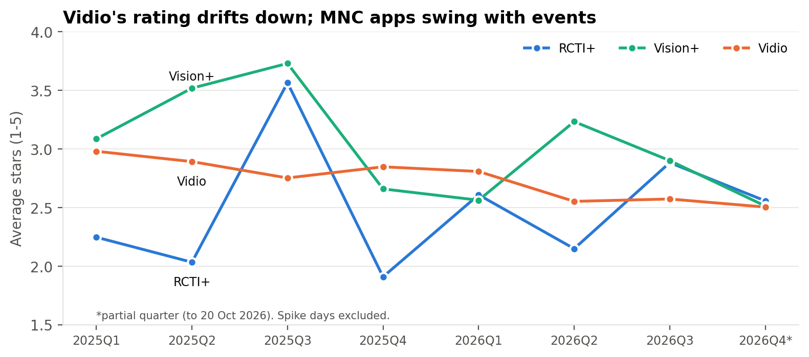
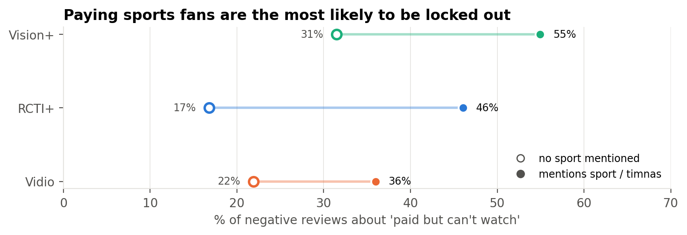

# MNC Media Cross-Platform Analytics

End-to-end analytics project on two public data sources: the YouTube performance of 8 Indonesian TV channels (MNC Media vs. competitors) and Google Play reviews of 3 streaming apps (RCTI+, Vision+ vs. Vidio). It covers the full workflow, from API data collection to a Looker Studio dashboard.

> Independent portfolio project using public data. Not affiliated with MNC Media.

**Dashboard:** [Looker Studio](https://datastudio.google.com/reporting/2eb8f5a8-02de-43b1-8d1a-ad65ceffbcd4) · **Slides:** [PDF](docs/slides.pdf)

## Questions

1. **YouTube:** How effective are MNC's YouTube channels (RCTI, MNCTV, GTV, iNews) compared with SCTV, Indosiar, Trans7 and Trans TV?
2. **Apps:** What do users complain about most in RCTI+ and Vision+, compared with Vidio?

## Key findings

- **Volume without reach:** MNC posted 62.2% of the 8 channels' videos but earned only 25.5% of their views.
- **Vision+ access problem:** "paid but can't watch" drives 45.2% of Vision+ negative reviews, rising to 55% when the review mentions sports.
- **What works:** live re-uploads (median 53 views/day vs 8.7 for full videos) and weekend uploads (Sunday index 1.36).



Full results for all 9 hypotheses are in [Findings](#findings).

---

## Data

| Source | Tool | Scope | Rows |
|---|---|---|---|
| YouTube Data API v3 | `google-api-python-client` | 8 channels, videos published 1 Oct 2025 – 20 Oct 2026 | 106,303 videos |
| Google Play reviews | `google-play-scraper` | 3 apps, reviews from 1 Jan 2024 (max 20,000 per app) | 46,649 reviews |

Reviews per app: RCTI+ 13,004 · Vision+ 13,645 · Vidio 20,000. Vidio hit the 20,000 cap, so its data starts in Dec 2024 and three-app comparisons use Jan 2025 – Oct 2026. Reviewer names and photos are dropped before saving.

## Workflow



| Phase | What | Output |
|---|---|---|
| 1 | Data collection (YouTube API, Play Store) | `raw/` |
| 2 | Cleaning, feature engineering, labeling | `clean/` |
| 3A | EDA in Colab, hypothesis testing | 6 figures, H1–H9 |
| 3B | SQL analysis in MySQL | 5 `agg_*.csv` tables |
| 3C | Cross-checks Colab ↔ MySQL ↔ Excel ↔ Looker | `docs/checks.xlsx` |
| 4 | Looker Studio dashboard | 5 pages |

## Repository structure

```
mnc-media-cross-platform-analytics/
├── notebooks/
│   ├── 01_scrape_youtube.ipynb   # YouTube API + Play Store scraping, cleaning, labeling
│   └── 05_eda.ipynb              # EDA, hypothesis tests, figures, SQL/Looker exports
├── sql/
│   ├── 01_create_tables.sql      # database and tables
│   ├── 02_analysis.sql           # view + analysis queries Q1–Q6, H6
│   └── 03_looker_tables.sql      # 5 aggregate tables for Looker Studio
├── data/
│   ├── looker/                   # agg_*.csv (dashboard sources)
│   └── sample/                   # small samples of the clean tables
└── docs/
    ├── checks.xlsx               # reconciliation + label validation samples
    ├── validation/               # label validation samples (CSV)
    └── figures/                  # EDA figures
```

## Method

### 1. Data collection

- **YouTube:** API key created in Google Cloud Console and stored in Colab Secrets (`YOUTUBE_API_KEY`), never in code. For each channel: `channels.list` (by handle) → uploads playlist → `playlistItems.list` (50 per call) until 1 Oct 2025 → `videos.list` (50 IDs per call) for title, duration, views, likes, comments and tags. About 4,300 quota units in total (estimated from the number of calls; daily limit 10,000). Each channel is saved to its own file, so a rerun skips finished channels.
- **Play Store:** `reviews()` sorted by newest, 200 per batch with a 2-second pause, stopping at 1 Jan 2024 or 20,000 reviews.

### 2. Cleaning: flag, don't delete

**Videos (106,303 × 34)**
- UTC → WIB (Asia/Jakarta); day and hour are derived from WIB time.
- ISO 8601 duration → seconds → format: Shorts ≤180 s, Clip ≤10 min, Full >10 min, plus Live/Streaming. The API cannot tell real Shorts from short regular videos.
- 23 live/upcoming videos flagged `exclude_perf`; outliers flagged with an IQR fence on log10 views per channel × format.
- 36.9% of Trans TV titles were duplicates. They turned out to be repeated corporate ads, not scraping errors, so they are labeled *Promo & Korporat* and excluded from performance analysis.

**Reviews (46,649)**
- UTC → WIB.
- 566 negative reply times (the review was edited after the developer replied) set to NaN and flagged `reply_time_invalid`.
- Template replies: replies are normalized (lowercase, whitespace, agent tags like `[MR]` removed), then counted as templates if ≥20 are identical.
- Spike days: daily reviews ≥5× the app's daily median and ≥100 reviews. Result: RCTI+ 27 days, Vision+ 14, Vidio 8. Consecutive days are grouped into one event.

### 3. Labeling

- **Content genre:** rule-based dictionary of program names in titles and hashtags, after Unicode (NFKC) normalization, because YouTube tags are generic and `category_id` is almost always 24 (Entertainment). Coverage 94.8%. Genre labels are rule-based, 81% accurate on a 100-video sample (93% when Variety, Talent & Reality and Infotainment are merged); errors concentrate on the boundaries between non-fiction entertainment formats. A 96% score after fixes is not reported, because it was measured on the same sample used to fix the rules. About 24% of Indosiar videos only carry `#shorts` and cannot be labeled.
- **Complaint topics:** reviews are normalized (slang dictionary, e.g. `gk → tidak`, `nntn → nonton`) and tagged with keyword rules (multi-label, plus one primary topic per review by priority) and a `mentions_sport` flag. Primary-topic accuracy is 82% on 50 fresh reviews not used to build the rules (68% on the first round, which was used to improve them).

### 4. Analysis

- Performance base: 105,447 videos (excluding 23 live/upcoming and 833 promo videos).
- Metrics: views per day instead of lifetime views, and a **performance index** = views per day ÷ median of comparable videos (same channel and format); 1.0 = typical. Format adjustment changed conclusions: the midday slot looked strong (index 1.47) but drops to 1.06 once format is controlled for, so an "upload at midday" recommendation was withdrawn.
- SQL (MySQL 8): window functions (`SUM() OVER ()`, `LAG`), CTEs with `ROW_NUMBER`/`RANK`, conditional aggregation (`SUM(CASE …)`), `HAVING`.
- Aggregate tables hold only counts and sums, no averages, so Looker Studio can recompute ratios correctly at any filter level (e.g. `SUM(above_typical) / SUM(uploads)`).

### 5. Validation

- Views per channel match exactly between Colab and MySQL.
- Aggregate tables match the dashboard: 105,447 videos and 4,765,988,142 views (check A); 27,140 negative reviews: RCTI+ 7,857, Vidio 9,549, Vision+ 9,734 (check B).
- Label validation samples are stored in `docs/checks.xlsx`.

## Findings

| # | Hypothesis | Result | Key evidence |
|---|---|---|---|
| H1 | Vision+'s main problem is "paid but can't watch", linked to sports | Confirmed | 45.2% of Vision+ negative reviews; rises from 31% to 55% when the review mentions sports/national team |
| H2 | Review spike days are access failures during big broadcasts | Confirmed | "Paid but can't watch" is 35% on spike days vs 21% on normal days |
| H3 | Ads and payments are Vidio's problems, not MNC's | Confirmed | Ads: Vidio 14.6% vs Vision+ 2.9%; payments: Vidio 9.5% vs RCTI+ 0.9% |
| H4 | MNC leads on volume but trails on reach | Confirmed | 62.2% of videos, 25.5% of views |
| H5 | MNC under-uses Shorts | Revised | MNC trails in every format, not only Shorts |
| H6 | RCTI+ replies slowest and most "templated" | Confirmed | Replies to 44% of negative reviews, median 41.6 h, 86% templates; Vision+ 99% within 0.7 h |
| H7 | Live re-uploads are MNC's best format | New finding | Median 53 views/day vs 8.7 for Full videos |
| H8 | Upload day matters more than hour | New finding | MNC index Sunday 1.36, Saturday 1.15; hour slots only 0.84–1.07 |
| H9 | Talent & reality shows are MNC's most efficient genre | New finding | Index 1.24 but only 7.6% of MNC uploads |

App reply metrics cover Jan 2025 – Oct 2026 and exclude spike days.








## Recommendations

1. **Do more of what works:** live re-uploads and talent & reality shows.
2. **Shift some uploads to weekends:** the best-performing days get about half the weekday upload volume.
3. **Protect paid access during big sports broadcasts:** "paid but can't watch" reaches 55% of Vision+ negative reviews that mention sports.
4. **Faster, more personal replies on RCTI+:** learn from Vision+'s response time.

## Limitations

- Only the 8 main channels; separate program channels (e.g. RCTI drama channels) are out of scope, which likely understates RCTI.
- Views are lifetime views at scraping time; analysis uses views per day and medians to reduce age bias.
- Labels are rule-based (81–82% accuracy).
- Review text skews negative, so star shares are not comparable to the Play Store rating histogram. Three-star reviews are only 3–7%, so sentiment is reported as negative (1–2) vs positive (4–5).

## Reproduce

1. Google Cloud Console: create a project, enable YouTube Data API v3, create an API key, and add it to Colab Secrets as `YOUTUBE_API_KEY`.
2. Run `notebooks/01_scrape_youtube.ipynb` in Google Colab (writes to `MyDrive/mnc-analytics/raw` and `clean`). Packages: `google-api-python-client`, `google-play-scraper`, `pandas`, `numpy`.
3. Run `notebooks/05_eda.ipynb` for the EDA, figures and SQL exports.
4. MySQL 8: enable `local_infile` (`SET PERSIST local_infile = 1;` and `OPT_LOCAL_INFILE=1` in Workbench), then run the scripts in `sql/` in order.
5. Upload the `agg_*.csv` files to Google Sheets and connect them in Looker Studio.

## Tech stack

Python (pandas, numpy, regex, matplotlib) · Google Colab · YouTube Data API v3 · google-play-scraper · MySQL 8 · Excel · Looker Studio

## Author

**Archie Sinaga** · Informatics Engineering graduate, Universitas Sriwijaya · [GitHub](https://github.com/archiesinaga)
